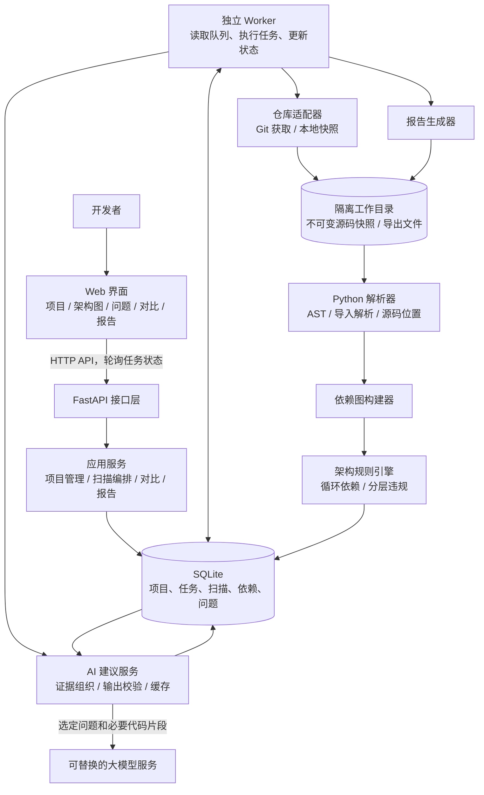

# ArchGuard 系统架构设计

> v0.1 早期方案。当前设计见 [ArchGuard Web 架构设计](web-architecture.md)。

版本：v0.1 · 日期：2026-11-05 · 状态：设计方案，尚未实现

## 1. 项目目标与范围

ArchGuard 是面向软件体系结构课程的 AI 辅助架构分析与重构助手。输入 Git 仓库或本地项目，通过静态分析提取依赖，检测循环依赖与分层违规，以架构图和源码证据说明问题，再由 AI 提出重构建议。开发者修改代码后重新扫描，验证问题是否解决。

核心闭环：**导入 → 扫描 → 定位 → 解释 → 人工重构 → 复扫 → 对比 → 报告**。

本方案按小组课程项目、单机部署设计。首版支持 Python 仓库；如果演示项目采用其他语言，应先替换首个解析器，再开始实现，避免同时开发多种语言支持。

| 首版必须完成 | 后续扩展 |
| --- | --- |
| 公开 HTTPS Git 仓库和本地 Git 工作区导入 | 私有仓库与平台授权 |
| Python 文件级依赖提取、包级聚合展示 | Java、TypeScript 等语言解析器 |
| 循环依赖、可配置的分层违规检测 | 高耦合、禁用依赖等更多规则 |
| 架构图、源码定位、AI 解释和建议 | 编辑器集成、补丁生成 |
| 扫描历史、前后对比、Markdown/HTML 报告 | CI 检查、多用户协作 |

首版由开发者审核建议并修改目标项目，系统不自动执行目标仓库代码，也不自动提交修改。

## 2. 总体架构

采用 **Web 前端 + 模块化单体后端 + 独立任务进程**。后端业务模块共用一套代码与数据库；扫描和 AI 请求在独立 Worker 中执行，避免长任务占用接口处理流程。

下面的箭头表示请求或数据流，不表示源码依赖方向。



**关键边界：规则引擎决定检测结果，AI 根据证据提供解释。** 模型不可凭空新增“已检测问题”，也不能直接把问题标记为已解决。

## 3. 技术方案与取舍

| 部分 | 建议方案 | 选择理由 |
| --- | --- | --- |
| 前端 | React + TypeScript + Vite | 组织项目、图谱、详情、对比等页面，统一接口类型 |
| 依赖可视化 | Cytoscape.js | 展示有向图，支持节点交互、过滤与布局 |
| 后端 API | Python + FastAPI + Pydantic | 统一接口校验、任务查询和业务编排 |
| Python 解析 | Python 3.12 的标准库 `ast` | 提取静态导入与源码位置；首版语法范围固定为 Python 3.12 |
| 图分析 | NetworkX | 构建有向图并计算强连通分量 |
| 存储 | SQLite + SQLAlchemy | 降低单机演示的安装和维护成本 |
| 后台任务 | 数据库任务表 + 单 Worker 进程 | 持久化任务状态，首版限制同时执行一个任务 |
| AI 接入 | `LLMProvider` 接口 + 一个实际服务适配器 | 将供应商配置与业务逻辑分离 |
| 报告 | Markdown + HTML 模板 | 便于查看、保存和课程提交 |
| 验证 | pytest；前端采用少量关键交互检查 | 优先验证依赖解析、规则与对比是否正确 |

以上是本项目的设计选择，不代表已安装这些依赖。具体版本在实现时验证并锁定。

技术依据：Python 的 [`ast`](https://docs.python.org/3.12/library/ast.html) 提供语法树处理能力；[NetworkX](https://networkx.org/documentation/stable/reference/algorithms/generated/networkx.algorithms.components.strongly_connected_components.html) 提供强连通分量计算；[Cytoscape.js](https://js.cytoscape.org/) 提供图可视化能力。结合 [FastAPI 对重型后台任务的说明](https://fastapi.tiangolo.com/tutorial/background-tasks/#caveat)，本方案将扫描放在独立进程中。首版不引入 Redis、Celery 或图数据库；若后续需要多机并发，再替换任务和存储适配器。

## 4. 逻辑分层与模块职责

源码依赖方向为：**接口层 → 应用层 → 领域层**。基础设施层实现应用层声明的接口，通过启动入口注入；领域层不引用 FastAPI、数据库或模型 SDK。

| 模块 | 输入与输出 | 主要职责 |
| --- | --- | --- |
| ProjectService | 仓库来源 → 项目记录 | 管理项目、Git 引用、规则配置 |
| SnapshotProvider | 仓库来源与引用 → Snapshot | 获取提交或复制工作区，生成冻结的分析输入 |
| LanguageAnalyzer | Snapshot + AnalysisConfig → AnalysisResult | 索引模块，解析导入，返回依赖与诊断信息 |
| GraphBuilder | 文件、依赖 → DependencyGraph | 去重、构图和包级聚合，保留源码证据 |
| RuleEngine | 图 + 规则 → Issue 列表 | 执行确定性的架构检查 |
| ScanService | 项目、版本、规则 → Scan | 编排各阶段，记录覆盖范围与扫描结果 |
| ExplanationService | Issue + 证据 → Explanation | 组织模型输入，校验和保存建议 |
| ComparisonService | 两次 Scan → Comparison | 检查可比性，计算问题和依赖变化 |
| ReportService | Scan 或 Comparison → Report | 生成摘要、证据、图谱说明和对比结果 |
| JobRunner | Job → 状态和结果 | 持久化排队、进度、超时与失败信息 |

扩展接口建议固定为：

```text
SnapshotProvider.create(source, ref) -> Snapshot
LanguageAnalyzer.analyze(snapshot, config) -> AnalysisResult
ArchitectureRule.evaluate(graph, config) -> list[Issue]
LLMProvider.explain(evidence, options) -> Explanation
ReportExporter.export(report_data) -> Artifact
```

先实现一个解析器、两条规则、一个模型适配器，保持接口简单。

## 5. 扫描流程与任务状态

1. 用户创建项目，配置源码根目录、排除目录和架构分层规则。
2. API 创建 Scan 和 Job，返回 `202 Accepted` 与任务 ID。
3. Worker 获取任务，生成不可变快照，固定配置与解析器版本。
4. 建立 Python 模块索引，解析文件并解析仓库内部导入。
5. 构建文件级依赖图，运行循环依赖和分层规则。
6. 在事务中保存结果与统计，标记静态扫描完成。
7. 用户选中问题后单独创建 AI 解释任务；AI 失败不影响静态结果。
8. 开发者在自己的工作区修改代码，运行目标项目的相关测试。
9. 对新提交或新的工作区快照扫描，与基线对比并导出报告。

任务状态：`queued → running → succeeded / failed`。运行阶段另存为 `snapshot / parse / graph / rules / persist`，不要将多个阶段混成无法解释的百分比。

扫描质量独立记录为 `complete / partial`。个别文件解析失败时允许形成部分结果，但必须展示失败文件、未解析导入数和已分析文件数；不可将部分扫描当作所有问题已解决的证明。

Worker 对任务更新心跳。进程异常退出后，将过期的运行任务标记为失败；用户可创建新任务重试。任务领取采用原子更新，结果按 Scan 隔离，避免重复写入；首版不自动恢复执行到一半的扫描。

### 快照与复现

- 远程仓库：记录输入引用、实际提交 SHA 和分析输入哈希。
- 本地项目：复制已纳入分析的文件到隔离目录，包含符合扫描规则的未跟踪源码，记录工作区状态。
- 输入哈希按排序后的相对路径和文件内容计算；配置与分析器版本分别记录。
- 复制前后核验原文件集合与内容，发生变化时重试或提示用户停止编辑后重扫，避免混合两个时刻的源码。
- 所有解析、源码展示和报告均引用同一份快照，不读取正在变化的工作区文件。
- 原始结果保持不可变；重新扫描创建新记录。

## 6. 依赖模型与规则语义

### 6.1 Python 导入解析

依赖边统一定义为 `A → B`：A 的源码静态导入 B。首版提供文件级分析，包级图用于聚合展示。

- 配置源码根目录，例如 `src`；建立模块名与源码文件映射。
- 处理绝对导入、相对导入、别名和包的 `__init__.py`。
- 对 `from package import name`，先判断 `package.name` 是否对应内部模块；否则指向可解析的 `package`，不把普通符号伪造为模块。
- 无法唯一解析的导入保留原文、位置与诊断信息，不猜测依赖目标。
- 第三方库和标准库默认不参与内部循环和分层违规统计。
- 标记 `TYPE_CHECKING` 下的导入，单独展示；默认不计入主规则图，并将此策略写入配置哈希。
- 函数内的静态导入仍计入静态图，同时标记出现位置；因此静态循环不等同于运行时必然报错。
- 动态导入、运行时修改路径等不承诺完整识别，报告应明确这些边界。

### 6.2 循环依赖

对文件级有向图计算强连通分量：成员数大于 1 的分量形成一个“循环依赖组”；单节点只有存在真实自导入边时才报告。每组保存成员、内部边，以及至少一条真实闭合路径作为证据。

包级聚合后，同包文件之间的依赖不转换成违规自环。包级环只作为结构观察，不能冒充已经验证的文件级循环。

默认展示循环组数与参与循环的文件数，不枚举全部简单环，避免在复杂图上生成大量重复结果。

### 6.3 分层违规

分层来自显式配置，下面是本项目定义的配置格式示例，不是现有工具的通用标准：

```yaml
version: 1
language: python
source_roots: [src]
exclude: [tests/**, .venv/**, build/**]
type_checking_imports: separate
layers:
  - name: presentation
    include: [src/demo/api/**]
  - name: application
    include: [src/demo/services/**]
  - name: domain
    include: [src/demo/domain/**]
  - name: infrastructure
    include: [src/demo/adapters/**]
allowed_dependencies:
  presentation: [application]
  application: [domain]
  domain: []
  infrastructure: [application, domain]
same_layer_dependencies: allow
unmatched_files: warn
rules:
  circular_dependency: {enabled: true, severity: warning}
  layer_violation: {enabled: true, severity: error}
```

规则语义：对已映射到层的内部依赖逐条检查；跨层目标未出现在允许集合中则违规，同层按 `same_layer_dependencies` 处理。同一文件命中多个层时配置校验失败；未命中层时单独警告，报告层映射覆盖率。

示例采用依赖倒置：应用层面向领域抽象，基础设施实现抽象，组装入口单独配置。其他项目也可以声明传统的 controller → service → repository 分层；系统不预设哪种风格唯一正确。

## 7. AI 建议服务

AI 输入包括规则说明、问题 ID、依赖路径、带行号的必要代码片段，以及项目约束。默认按问题生成，设置输入大小和响应超时。

建议输出包含：

```text
issue_id
summary：问题解释
evidence_refs：引用的文件、行号和依赖边
options[]：重构方案、修改步骤、涉及文件和取舍
validation_steps[]：建议运行的测试和复扫检查
uncertainties[]：证据不足或需要人工确认的内容
```

返回结果通过结构校验，并校验引用是否属于该扫描的证据集合。通过校验只说明结构和引用有效，建议仍需要人工审核。

源码和仓库文档属于待分析数据，其中的文字不能成为模型指令。模型不获得执行代码、访问本地其他文件或提交 Git 的工具权限。外部模型请求前，用户可查看发送内容；默认只发送相关片段，排除密钥文件。密钥通过环境配置提供，日志不保存密钥。

缓存键包含快照哈希、问题指纹、提示词版本和模型配置。未配置模型、超时或配额不足时，显示静态结果和解释失败原因，可重试。

## 8. 核心数据模型

所有持久化记录通过 `project_id` 或所属 Scan 关联；文件路径使用仓库相对路径。

| 实体 | 关键字段 |
| --- | --- |
| Project | id、name、source_type、source、default_ref |
| Scan | id、project_id、commit_sha、snapshot_hash、config_hash、analyzer_version、status、quality、coverage、created_at |
| Job | id、kind、scan_id、status、phase、heartbeat_at、error |
| SourceFile | id、scan_id、relative_path、module_name、content_hash、parse_status、layer |
| Dependency | id、scan_id、source_file_id、target_file_id、kind、evidence_locations |
| Diagnostic | id、scan_id、file_id、code、message、line |
| Issue | id、scan_id、rule_id、severity、fingerprint、summary、evidence |
| Explanation | id、issue_id、status、model、prompt_version、content、error |
| Comparison | id、baseline_scan_id、target_scan_id、comparability、summary |
| Report | id、scan_id 或 comparison_id、format、artifact_path、created_at |

同一文件对的多次导入聚合为一条依赖，保留多处位置。大块源码和报告保存在文件系统，数据库保存索引与结构化结果；首版不额外维护一套图数据库。

问题指纹排除行号，以避免普通代码插入造成问题身份变化：分层违规使用规则 ID、源/目标路径和层信息；循环组使用规则 ID、排序后的文件成员和内部依赖边。循环结构或路径变化会产生新指纹，应同时展示依赖差异，避免把重命名误读为修复。

## 9. 对比与“改善”的判定

可比较条件：同一项目、相同源码范围、规则配置、解析器版本和依赖过滤策略。条件不一致时允许查看两份报告，但标记为不可直接评价的对照。

同条件下，按指纹区分仍存在、目标扫描不再检出和新增问题；展示新增/删除依赖边。文件删除、未解析、层映射缺失等也会造成问题消失，需要单独说明。

只有两次扫描完整、相关文件正常解析且没有通过缩小范围隐藏问题时，才将“不再检出”作为已解决候选；最终结合重构差异和目标项目测试结果确认。测试由开发者执行并附证据，首版扫描器不运行仓库测试。

对比指标包括：循环组数、参与循环的文件数、分层违规数、文件解析覆盖率、层映射覆盖率、未解析导入数，以及相关测试结果。首版不提供缺乏明确依据的综合健康分。

## 10. API 与页面

| 方法与路径 | 用途 |
| --- | --- |
| `POST /api/projects` | 创建项目 |
| `GET /api/projects` | 项目列表 |
| `PUT /api/projects/{id}/config` | 校验并更新扫描配置 |
| `POST /api/projects/{id}/scans` | 创建扫描任务，冻结本次配置 |
| `GET /api/projects/{id}/scans` | 扫描历史 |
| `GET /api/jobs/{id}` | 任务状态、阶段和错误 |
| `GET /api/scans/{id}` | 摘要、版本与覆盖情况 |
| `GET /api/scans/{id}/graph` | 图数据，支持粒度和子图过滤 |
| `GET /api/scans/{id}/issues` | 问题列表和筛选 |
| `GET /api/scans/{id}/files/{file_id}` | 快照中的受控源码片段 |
| `POST /api/issues/{id}/explanations` | 创建 AI 解释任务 |
| `GET /api/issues/{id}/explanations` | 查询解释结果 |
| `POST /api/comparisons` | 创建基线与目标扫描的对比 |
| `GET /api/comparisons/{id}` | 读取对比结果 |
| `POST /api/reports` | 创建导出任务 |
| `GET /api/reports/{id}/download` | 下载报告 |

创建解释、扫描和报告返回任务 ID；创建对比首版可同步完成。前端轮询任务状态，后续需要实时事件时再增加 SSE。

页面分为项目页、扫描详情页、对比页与报告预览。扫描详情采用“概览 + 架构图 + 问题列表 + 源码/AI 详情”；点击问题高亮实际依赖路径。大图默认包级聚合，允许按问题展开文件子图，避免一次绘制所有节点。

## 11. 建议目录与部署

```text
ArchGuard/
├── frontend/src/
│   ├── pages/            # 项目、扫描、对比、报告
│   ├── features/         # 图谱、问题、AI 详情
│   └── api/              # 类型与请求封装
├── backend/
│   ├── app/
│   │   ├── api/          # 路由、请求与响应模型
│   │   ├── application/  # 用例、任务编排、接口定义
│   │   ├── domain/       # 图模型、规则、指纹、对比逻辑
│   │   ├── infrastructure/
│   │   │   ├── git/      # 仓库和快照
│   │   │   ├── analyzers/python/
│   │   │   ├── persistence/
│   │   │   ├── llm/
│   │   │   └── reports/
│   │   ├── bootstrap.py  # 实例创建与依赖注入
│   │   ├── main.py       # API 启动入口
│   │   └── worker.py     # 独立任务入口
│   └── tests/
├── fixtures/             # 小型正反例，仅用于验证
├── docs/
│   └── architecture.md
└── README.md
```

运行时数据库、快照、日志与报告存入可配置的数据目录，加入 Git 忽略。单机运行一个 API 进程和一个 Worker，共享本机 SQLite 与数据目录；事务保持简短，配置锁等待。首版不支持跨机器共享 SQLite。

默认仅本机访问。导入限制为允许的公开 HTTPS Git 主机或配置的本地根目录，限制文件数量、大小、耗时与路径范围；拒绝越界路径和指向快照外的链接。拉取目标仓库不安装依赖、不执行构建、测试或脚本，禁用子模块及外部过滤器等额外行为。若后续开放到网络，需要补充身份认证、项目隔离和出站访问控制后再部署。

## 12. 开发阶段与验收

以下是工作顺序，具体周期由组员数量和课程期限确定。

| 阶段 | 交付内容 | 验收条件 |
| --- | --- | --- |
| 一：分析内核 | 快照、解析器、依赖图、两类规则 | 固定正反例得到预期依赖、循环组与违规源码位置 |
| 二：应用闭环 | API、任务、存储、项目与扫描页 | 导入真实项目，异步完成扫描并可回看同一份结果 |
| 三：可视化与 AI | 图谱联动、源码定位、AI 解释 | 点击问题可看到闭合路径或违规边；模型失败仍能查静态结果 |
| 四：复扫与报告 | 对比页、报告、真实项目演示 | 同条件复扫能解释问题和依赖变化，并附相关测试结果 |

验证重点：绝对/相对/符号导入、源码根目录、三节点环与无环反例、层匹配冲突与缺失、工作区快照变化、Worker 失败、模型超时，以及配置不同或解析不完整时禁止误报“全部修复”。

正式演示使用真实项目的固定提交，并先确认存在可解释、可小范围修复的问题。人工构造的小项目用于规则验证，不代替真实项目成果；未确定演示仓库前，不承诺具体问题数量或改善比例。

建议分工按模块进行：分析与规则、后端与任务、前端与图谱、AI/报告与案例验证；人数较少时合并相邻职责。阶段一开始前，先共同确定真实演示仓库和统一数据模型。

课程答辩可展示的架构取舍包括：模块化单体与进程隔离、领域与基础设施解耦、语言/模型适配器、确定性检测与 AI 的职责分离，以及基于不可变快照的可复现对比。
