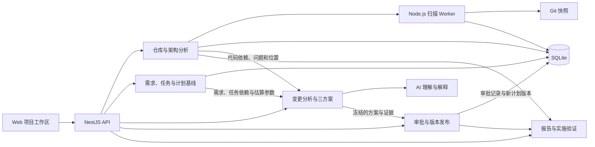

# ArchGuard Web 架构设计

版本 v0.2 · 2026-11-09 · 设计方案

## 1. 项目定位

ArchGuard 在原有 Git 仓库分析、循环依赖与分层违规检测、AI 重构建议、架构图及报告的基础上，增加需求变更影响分析和审批。两部分围绕同一个项目工作区，通过 **需求 → 任务 → 代码模块** 的显式关联共享证据。

主流程是 **登记变更 → 定位需求和代码 → 确认受影响任务 → 计算三个方案 → 审批并生成新计划 → 实现变更 → 复扫并核对**。架构扫描既可独立运行，也可作为变更申请的技术依据。处理循环依赖等技术债时，可以从扫描问题直接发起变更申请。

首版按一个项目、一份带编号的需求文档、一份任务计划、一个 Git 仓库设计。用同一真实 JS/TS 仓库贯穿两门课程演示。选择已有的代码架构问题作为案例，并准备一项会触及相关模块的需求变更，验证业务变更和技术治理如何衔接。

## 2. 部署与模块

采用 **React + TypeScript 前端、Node.js + NestJS 模块化单体后端、独立扫描 Worker**。首版假设分析 JS/TS 仓库，使用 TypeScript Compiler API 提取静态导入，再结合项目配置解析内部模块路径。扫描结果和任务状态保存在 SQLite，源码快照和报告存入本地数据目录。前端使用 Cytoscape.js 展示两类依赖图。

技术参考。[NestJS 模块](https://docs.nestjs.com/modules) · [TypeScript Compiler API](https://github.com/microsoft/TypeScript/wiki/Using-the-Compiler-API) · [SQLite 事务](https://www.sqlite.org/lang_transaction.html) · [Cytoscape.js](https://js.cytoscape.org/)

下图箭头表示业务调用或数据流。



| 模块 | 输入 | 输出与边界 |
| --- | --- | --- |
| 项目与计划 | 需求文档、任务表、依赖、费率、关联 | 版本化计划基线，校验缺失 ID、引用和任务环 |
| 代码架构分析 | 仓库引用、提交、扫描配置 | 文件和模块依赖、循环组、分层问题、源码位置和扫描覆盖率 |
| 变更分析 | 变更描述、计划版本、扫描版本 | 需求与模块候选、任务影响路径、待核对项 |
| 方案估算 | 经确认的任务、范围差异、工时与工期参数 | 三个方案的工时、成本、工期和里程碑变化 |
| 审批 | 一个固定版本的变更申请、角色与意见 | 审批记录、正式计划版本或延期待办 |
| AI 适配器 | 变更描述和检索出的结构化证据 | 候选匹配、修改建议和解释，供人工核对 |
| 实施验证与报告 | 审批记录、基线和复扫结果、测试证据 | 可追溯的变更报告和架构前后对比 |

扫描任务由 API 入队，Worker 领取任务并记录进度，浏览器轮询状态。首版可用 SQLite 任务表和单 Worker，提交扫描后立即返回任务 ID。规则计算和审批分别是普通模块与事务用例，可独立验证。AI 请求只发送选定证据片段，模型密钥由后端保存。

扫描内核、任务影响遍历和排程计算放在可独立调用的 TypeScript 模块中，API 与 Worker 复用这些模块。前后端共享请求和响应类型，前端消费计算结果。导入时冻结提交、扫描范围和规则配置。解析器从静态导入与重新导出生成带位置的边，无法解析的路径单独报告。代码环按强连通分组，分层违规按配置的允许方向判断。扫描仅读取快照中的代码。

## 3. 两张图与跨图关联

两种箭头有不同含义，页面和数据结构分别建模。

| 关系 | 方向与含义 | 变更时如何遍历 |
| --- | --- | --- |
| 代码依赖 | `A → B` 表示 A 导入 B | B 改动时，沿反向依赖找 B 的调用方，形成复核候选 |
| 任务依赖 | `A → B` 表示 B 等待 A 完成 | A 改动时，沿正向依赖找 B 和其他后继 |
| 需求与任务 | `R → T` 表示 T 实现或验证需求 R | 由需求定位任务，也可从任务查看负责的需求 |
| 任务与模块 | `T ↔ M` 表示任务涉及模块 M | 两边均可检索，按项目配置保留关联来源 |

首版允许在项目工作区维护需求编号、任务编号和代码路径前缀的映射。例如 `REQ-07 → TASK-12 ↔ src/export/**`。代码模块 ID 采用项目内稳定标识，扫描按配置匹配文件路径。文件找不到、模块重命名或映射过期时，显示待核对项。AI 可建议补充映射，由成员确认后保存。

分析时合并两条证据链，一条从需求找到直接任务，另一条从涉及的模块找到调用方，再通过模块映射补充任务候选。去重后沿任务图找后继，保留至少一条可展示的影响路径和来源。把任务区分为 **需要改动、需要复核、仅受排期影响**。同一任务可能同时拥有多个来源。仅有传递依赖的任务不会自动增加工时，安排复核或回归测试时应显式估算。

代码图中的环作为架构问题呈现，遍历时使用访问集合。任务图用于排程，发现环应显示循环链并暂停该方案计算。这样能在演示中直观区分软件循环依赖和计划依赖错误。

## 4. 三个方案如何生成和计算

变更描述首先检索项目内的需求编号、标题、正文关键词和任务名称。AI 将候选整理成结构化结果，包括涉及的需求 ID、任务 ID、代码模块、拟增删的范围和证据引用。后端验证 ID 和证据归属。没有匹配到已有需求时，申请人可标记为新需求并指定关联。首版用关键词检索和人工确认即可跑通完整流程。

每个方案是一份对计划基线的可编辑差异，记录需求范围、任务增删改、依赖修改、工时、假设和风险。例如缩小范围可能留下可追踪的功能缺口，延期可能推迟收益。AI 可以草拟差异，申请人确认估算输入后由后端重算。已有任务工时用于基线和参考，新增工时必须提供历史同类任务、明确规则或人工估值来源。估算缺项时显示待补充。

| 方案 | 计划差异 | 对比口径 |
| --- | --- | --- |
| 接受变更 | 将完整范围纳入当前版本，新增或修改任务与依赖 | 展示当前版本的新增人时、成本和交付变化 |
| 缩小范围 | 明确保留和舍弃的需求项，重新生成对应任务差异 | 按实际保留范围重新排程和估算 |
| 延后实施 | 当前交付任务网络保持原安排，将变更记录到未来待办 | 分列当前版本影响和未来估算，未来计划未确定时将未来工期标为待排期 |

排程首版采用完成后才能开始的依赖，基于同一相对起点和剩余任务重算。各任务可录入预计持续时长，缺省时采用 `工期（工作日）= 工时（人时）÷ 有效投入（人时/工作日）`。先用统一的 8 人时/工作日演示。任务可并行，暂不计算资源冲突与节假日。计划有明确里程碑时，使用其前置任务确定完工时间。

```text
任务最早开始 = max(前置任务的最早完成)，没有前置则取 0
任务最早完成 = 最早开始 + 预计持续时长
版本工期 = max(交付所需末端任务的最早完成)
交付变化 = 方案版本工期 − 基线版本工期
工作量变化 = 方案任务工时总和 − 基线任务工时总和
人工成本变化 = Σ(方案任务工时 × 任务费率) − Σ(基线任务工时 × 任务费率)
```

工作量以任务 ID 去重。工时、持续时长和交付变化分别显示。影响到任务的日期与增加该任务的工时是两项独立结果。以同一价格和计算规则版本对比，并记录费率、适用范围及公式版本。

### 示例计算

假设要增加导出审计记录和查询界面。现有导出服务、界面、回归测试依次安排，工时分别为 16、8、8 人时。这条链为 4 个工作日。同一版本还有一条独立的 5 日任务链，因此基线交付时间为 5 个工作日。三项任务的费率依次为 150、120、100 元/人时，以下数值是演示输入。

| 方案 | 增量输入 | 当前版本额外工作量 | 当前版本人工成本增量 | 当前版本交付变化 |
| --- | --- | ---: | ---: | ---: |
| 接受 | 服务 +16、界面 +4、测试 +4 人时 | 24 人时 | 3,280 元 | +2 工作日，任务链从 4 日到 7 日 |
| 缩小 | 只记录事件，服务 +6、测试 +2 人时 | 8 人时 | 1,100 元 | 0，任务链从 4 日到 5 日 |
| 延后 | 纳入未来待办 | 0 人时 | 0 元 | 0，未来暂估 24 人时、3,280 元，工期待排期 |

## 5. 审批、发布与复扫

变更申请记录固定的 `basePlanVersionId`、`scanId`、`scenarioRevisionId`、所选方案及估算输入。申请人提交前可以修改方案。修改已提交的范围或估算时生成新版本并重新提交。审批者查看同一份证据、任务差异、时间和成本对照。

- **草稿 → 待审批。** 冻结一个可执行方案，记录申请人和提交时间。关键映射、依赖或估算有缺项时提示补齐。
- **待审批 → 已拒绝。** 保存意见和当时的方案快照。
- **待审批 → 已批准并入计划。** 校验角色、申请状态、方案版本和当前计划版本，在同一个数据库事务中写入决策并生成新计划版本。选择延后实施时，新版本写入延期待办，当前交付任务保持原安排。
- **基线过期。** 另一项变更已发布新计划时，返回版本冲突。申请人基于新版本重算并重新提交。重复请求应返回已有审批结果或冲突，不重复修改计划。
- **实施验证。** 团队完成代码修改后提交实施版本、测试结果和复扫结果。复扫采用相同扫描配置与分析器版本，展示已消失、新增和仍存在的架构问题，并核对实际改动模块与原影响分析。分析范围不一致或存在解析缺口时单独标记。

审批状态和实施状态独立记录。批准表示计划决策已生效。完成实施需要需求验收和测试证据。对延期方案，实施状态为等待排期。

## 6. 数据与 Web 接口

| 对象 | 主要字段或关联 |
| --- | --- |
| Project | 仓库、当前计划版本、成员角色 |
| PlanVersion | 父版本、需求和任务快照、任务依赖、任务与模块映射、费率、延期待办 |
| Scan | 提交或快照 ID、扫描配置、解析器版本、依赖边、源码证据、架构问题 |
| ChangeRequest | 项目、原始描述、申请人、申请状态、固定的基线和扫描 |
| ScenarioRevision | 方案类型、版本、任务差异、证据路径、估算输入、计算结果和规则版本 |
| ApprovalDecision | 申请、方案版本、审批人、结论、意见、时间、生成的计划版本 |
| ImplementationCheck | 已批准申请、基线扫描、实施提交、复扫 ID、测试证据和验收结论 |

首版可存储不可变的计划快照，避免为课程项目实现复杂的版本差异存储。一个计划内使用稳定的需求与任务 ID。复扫结果、估算和审批历史都保存关联版本，旧报告可以重现当时依据。

| 页面 | 用户操作 | 接口示例 |
| --- | --- | --- |
| 项目与计划 | 导入需求、维护任务依赖和映射、查看基线 | `POST /projects/:id/plan-versions` |
| 架构扫描 | 输入 Git 地址或选择版本、浏览架构图和源码证据 | `POST /projects/:id/scans`、`GET /scans/:id` |
| 变更分析 | 输入描述、确认影响路径、编辑三套方案参数 | `POST /projects/:id/change-requests`、`POST /change-requests/:id/analyses` |
| 方案与审批 | 对照三种方案、选定一个提交、审批与查阅记录 | `POST /change-requests/:id/submit`、`POST /change-requests/:id/decisions` |
| 实施与报告 | 绑定测试和复扫、导出变更影响与架构变化 | `POST /change-requests/:id/implementation-checks`、`GET /change-requests/:id/report` |

页面复用同一套项目导航。代码图和任务图分别显示，点击一个模块可定位关联任务，点击任务可返回需求、源码证据和前后计划差异。架构页保留独立扫描及报告入口。

## 7. 最小交付与课程演示

1. **建立两个可验证的分析内核。** 从一个真实仓库提取静态依赖，检测循环和分层违规。用一份需求文档和任务表构建任务网络，校验循环、排程和成本计算。
2. **接通跨图证据。** 为案例建立少量需求、任务和模块映射，录入变更，人工核对代码调用方与下游任务是否完整。记录实际需修改的任务和仅排期受影响的任务。
3. **实现三方案与审批。** 用同一基线生成方案对照，审批后生成新计划。验证拒绝、重复审批、过期基线和延期待办。
4. **实现、复扫并导出。** 按已批准范围修改代码，运行相关测试，复扫验证架构变化，再导出包含影响路径、计算依据、审批记录和复扫结论的报告。

最小验收用例应包含一例代码循环、一例分层违规、一例共享后继导致的重复计数、一例工时增加但交付日期不变，以及一例任务环导致排程失败。影响识别与人工标注的任务集对照，排程和成本与手算结果对照。若正式演示采用不同仓库，先核实其许可、固定提交与可运行的相关测试，再按实际范围填写案例数据。

软件体系结构课程可以评价模块边界、代码依赖与重构证据。项目管理课程可以评价范围取舍、工期和成本计算、风险记录与审批追溯。两项成果共用同一次变更的证据链。
